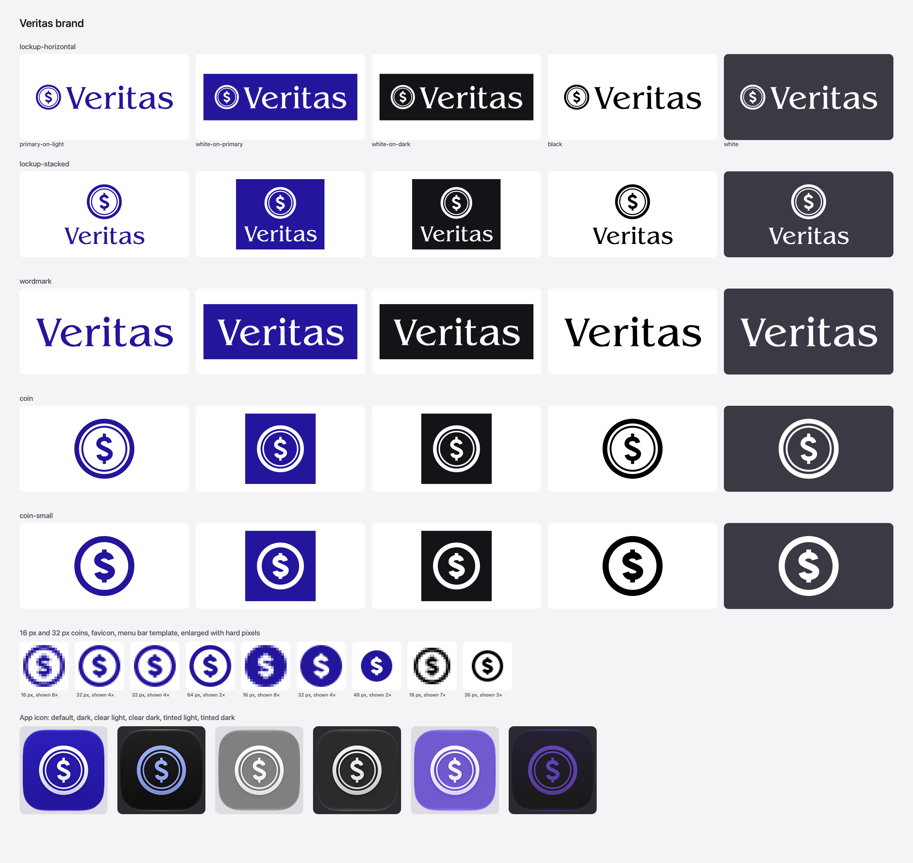

# Veritas brand

Ryan's brand: the colors in `brand/colors.txt`, the logo he made in Canva (`brand/Veritas.png`) and the coin from Bootstrap Icons (`brand/coin.svg`, MIT). Everything here is generated from those three files by the scripts in `tools/brand/`.



## The logo

- **Wordmark.** "Veritas" in ITC Benguiat, traced from Ryan's PNG into outlines. No font file is used or shipped; the outlines are the only copy. [trace-comparison.png](trace-comparison.png) sets the trace over the PNG.
- **Coin.** A ring, an inner ring and a dollar sign, after Bootstrap Icons' coin. The $ is redrawn as a point-symmetric S, and the ring weights sit between the wordmark's hairlines and stems.
- **Small coin.** For 32 px and below: no inner ring and a heavier $, so it holds together at 16 px.
- **Horizontal lockup.** The coin is 1.08× the cap height, centred on the capitals, with a gap of 0.2× the cap height. Round forms look smaller than flat ones, and the V's slant opens the gap at mid-height, so both are tighter than in the PNG.
- **Stacked lockup.** The coin is 2× the cap height, centred over the wordmark, 0.42× the cap height above it.

## Colors

| Name | Hex | Use |
|---|---|---|
| Primary | #23169C | The logo, the accent, Wrapped's cards |
| Secondary | #007EA7 | Links, income, secondary emphasis |
| Bad | #DB162F | Overspent, losses |
| Good | #56E39F | Available, savings |
| Warning | #F5B700 | Low |

These exact values are for fills, bars, dots and chart marks. Text and small icons use same-hue shades that reach WCAG AA; `design/tokens.md` lists them.

## Pairings

| File suffix | Ink | Ground |
|---|---|---|
| `primary-on-light` | Primary | White or any light surface |
| `white-on-primary` | White | Primary |
| `white-on-dark` | White | #141418 or any near-black |
| `black` | Black | Light surfaces, one-color print |
| `white` | White | Photos and dark surfaces, one-color print |
| no suffix | `currentColor` | Inherits the text color: web pages, icons in other apps |

In the app, the logo takes `color-accent`: primary in light mode and #94A8FE in dark mode.

## Clear space and minimum size

- Keep clear space of half the cap height on every side of a lockup or the wordmark, and a quarter of the diameter around the coin. The `white-on-*` files include it in their background.
- Smallest sizes: the horizontal lockup at 11 px cap height (about 90 px wide), the wordmark at 10 px cap height, the full coin at 33 px. Below 33 px use the small coin; at 16 px use `favicon` or `small/coin-16-*`.

## Don't

- Don't set "Veritas" in a font. Use the outlines.
- Don't recolor the logo outside the pairings above, add gradients, outlines or shadows, or put it on a busy photo without the `white-on-dark` ground.
- Don't stretch, rotate or skew it, or change the spacing of a lockup.
- Don't use the full coin below 33 px or the small coin above 64 px.
- Don't put the logo on financial statements. They belong to the budget's owner.

## Files

| Path | What |
|---|---|
| `svg/{wordmark,coin,coin-small,lockup-horizontal,lockup-stacked}.svg` | Masters in `currentColor` |
| `svg/*-{primary-on-light,white-on-primary,white-on-dark,black,white}.svg` | Color variants of each master |
| `small/coin-{16,32}-{primary,black,white}.{svg,png}` | The small coin, at 1× and 2× |
| `favicon/favicon.svg`, `favicon.ico`, `favicon-*.png` | A primary disc with a white $, for tabs, bookmarks and touch icons |
| `menubar/MenuBarTemplate.{svg,png}` | A black template image for the menu bar, 18 pt at 1×, 2× and 3×. macOS tints it; set `isTemplate` |
| `app-icon/AppIcon.icon` | The Icon Composer app icon: rings and $ as two glass layers on primary, with a dark appearance. The system draws the clear and tinted ones. The app uses a copy at `apps/macos/Veritas/AppIcon.icon` |
| `app-icon/png/icon_*.png` | The icon rendered by `ictool` at every size an `.appiconset` takes, for the web and for older macOS versions |
| `app-icon/png/appearance-*.png` | The icon in each appearance |
| `source/wordmark-traced.svg` | The trace, in units where the cap height is 700 and the baseline is 0 |
| `preview.png`, `trace-comparison.png` | Proof sheets |

## Regenerating

From the repository root, with nothing to install:

```sh
swift tools/brand/trace-wordmark.swift    # brand/Veritas.png → source/wordmark-traced.svg
swift tools/brand/build-brand.swift       # everything else, plus the app's AppIcon.icon and BrandArtwork.swift
python3 tools/brand/palette.py            # prints the text-safe shades for design/tokens.css
```

The tracer reads `brand/Veritas@4x.png` instead when it exists. Add `--overlay out.png` to see the fitted outline and its nodes over the upscaled source. The app icon PNGs need Xcode's Icon Composer (`ictool`).
